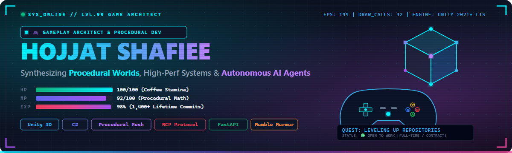

<div align="center">

  <!-- Self-Hosted High-Resolution Cyberpunk / Retro Gaming HUD Banner -->
  <a href="https://github.com/hojjat-shafiee">
    
  </a>

  <br/><br/>

  <!-- Gamer Status & Level Badges -->
  <a href="https://github.com/hojjat-shafiee">
    
  </a>
  <a href="https://github.com/hojjat-shafiee">
    
  </a>
  <a href="mailto:better_call_hojat@proton.me">
    
  </a>
  <a href="https://github.com/hojjat-shafiee">
    
  </a>
  <a href="https://github.com/hojjat-shafiee">
    
  </a>

  <br/><br/>

  <!-- Quick Action & Store Badges -->
  <a href="https://hojjat-shafiee.itch.io">
    
  </a>
  &nbsp;
  <a href="https://www.linkedin.com/in/hojjat-shafiee/">
    
  </a>
  &nbsp;
  <a href="mailto:better_call_hojat@proton.me">
    
  </a>
  &nbsp;
  <a href="https://github.com/hojjat-shafiee">
    
  </a>

  <br/><br/>

  <!-- Gamepad HUD Controls & Navigation -->
  <p align="center">
    <code>🕹️ CONTROLS: [W][A][S][D] Move • [SPACE] Jump to Code • [E] Equip Loadout • [ENTER] Co-op</code>
  </p>
  <p align="center">
    <b><a href="#-character-sheet--hud-telemetry">📜 Character Sheet</a></b> &nbsp;•&nbsp;
    <b><a href="#-retro-arcade-live-contribution-grid">👾 Arcade Radar</a></b> &nbsp;•&nbsp;
    <b><a href="#-active-quests--boss-battles">🗺️ Active Quests</a></b> &nbsp;•&nbsp;
    <b><a href="#-gamer-trophy-room--achievements">🏆 Trophy Room</a></b> &nbsp;•&nbsp;
    <b><a href="#️-the-armory--weapon-loadout">⚔️ The Armory</a></b> &nbsp;•&nbsp;
    <b><a href="#-quest-archive--repository-directory">📜 Quest Archive</a></b> &nbsp;•&nbsp;
    <b><a href="#-save-point--multiplayer-co-op">💾 Co-op</a></b>
  </p>

</div>

---

### 📜 Character Sheet & HUD Telemetry

```text
╔══════════════════════════════════════════════════════════════════════════════════════════════╗
║  PLAYER:    Hojjat Shafiee             CLASS:    Systems Architect & Gameplay Engineer       ║
║  LEVEL:     99 (10+ Yrs Experience)    STATUS:   🟢 OPEN TO WORK (Full-time / Contract)       ║
║  SPECIALTY: Procedural Worlds & MCP    BASE:     Isfahan, Iran [32.65°N, 51.66°E]            ║
╠══════════════════════════════════════════════════════════════════════════════════════════════╣
║  VITALS & REPUTATION:                                                                        ║
║  HP   [████████████████████] 100/100  ➔ High Caffeine Tolerance & Deep Debugging Stamina     ║
║  MANA [██████████████████░░]  92/100  ➔ Procedural Algorithms & Dynamic Mesh Synthesis       ║
║  EXP  [███████████████████░]  98%     ➔ 1,400+ Lifetime Contributions & 48-Day Active Streak ║
║                                                                                              ║
║  ATTRIBUTES & STATS:                                                                         ║
║  ⚔️ [STR] 99/99 ➔ Unity Engine Architecture (2D/3D, URP/HDRP, C# .NET, Multi-Threading)      ║
║  🔮 [INT] 98/99 ➔ Procedural Geometry Synthesis (DFS Mazes, Heightmaps, Runtime Meshes)      ║
║  📡 [WIS] 95/99 ➔ Agentic AI & Model Context Protocol (MCP Server for Unity & Figma)         ║
║  ⚡ [AGI] 94/99 ➔ Game Jam Velocity & Rapid Prototyping (GitHub Game Off 2025: Tidebreak)    ║
║  🎨 [DEX] 90/99 ➔ Technical Art & Shaders (ShaderLab, HLSL, Post-Processing, Blender 3D)     ║
╠══════════════════════════════════════════════════════════════════════════════════════════════╣
║  EQUIPPED LOADOUT:                                                                           ║
║  • Primary Weapon:  Unity 2021+ LTS • C# 12 • Procedural Mesh Engine • Custom Shaders        ║
║  • Secondary Gear:  Python 3.12 • FastAPI (Async) • ZeroC ICE RPC • Mumble VoIP Microservice ║
║  • Relic / Tooling: Model Context Protocol (MCP) • Figma UI/UX • Docker & Debian 12          ║
║  • Guild Affiliation: GitHub Game Off 2025 Participant (Tidebreak)                           ║
║  • Core Motto:      "Simulate the universe with math, then make it engaging."                ║
╚══════════════════════════════════════════════════════════════════════════════════════════════╝
```

- 🎮 **Game Engineering & Graphics:** Specializing in **Unity (2D/3D)**, algorithm-driven procedural mesh synthesis (DFS mazes, terrain heightmaps), custom shaders, and responsive player movement systems.
- 🤖 **Agentic Engineering & MCP:** Pioneering integrations for the **Model Context Protocol (MCP)**, connecting LLM agents (Claude, Cline, Qoder) directly into a live Unity Editor session to automate scene hierarchy management, prefab wiring, and script edits.
- ⚡ **Multiplayer Backends & VoIP:** Architecting asynchronous REST APIs using **FastAPI** coupled with **ZeroC ICE RPC** protocols to control Mumble Murmur voice servers for low-latency multiplayer game communication.

---

### 👾 Retro Arcade: Live Contribution Grid

<div align="center">

  <p>
    <code>🕹️ INSERT COIN TO PLAY • HIGH SCORE: 1,427+ COMMITS • COMBO: 48-DAY STREAK • DIFFICULTY: HARDCORE</code>
  </p>

  <!-- Live Animated Snake Eating Real Contributions -->
  <picture>
    <source media="(prefers-color-scheme: dark)" srcset="https://raw.githubusercontent.com/hojjat-shafiee/hojjat-shafiee/output/github-contribution-grid-snake-dark.svg" />
    <source media="(prefers-color-scheme: light)" srcset="https://raw.githubusercontent.com/hojjat-shafiee/hojjat-shafiee/output/github-contribution-grid-snake.svg" />
    
  </picture>

  <br/><br/>

  <!-- Live Streak Stats Radar -->
  <a href="https://github.com/hojjat-shafiee">
    
  </a>

</div>

---

### 🗺️ Active Quests & Boss Battles

<table width="100%">
  <tr>
    <td width="50%" valign="top">
      <div align="center">
        <h3>🤖 Quest 01: Figma MCP Browser</h3>
        <p>
          
          
          
          
        </p>
      </div>
      <p><b>Mission Brief:</b> Bridge autonomous AI agents directly with local Figma instances without paid API keys. Enables programmatic inspection of design trees, component extraction, and automated UI token generation.</p>
      <div align="center">
        <a href="https://github.com/hojjat-shafiee/figma-mcp-browser"><b>⚔️ Accept Quest / View Repository →</b></a>
      </div>
    </td>
    <td width="50%" valign="top">
      <div align="center">
        <h3>🎮 Quest 02: 3D-Maze-Generator</h3>
        <p>
          
          
          
          
        </p>
      </div>
      <p><b>Mission Brief:</b> Algorithm-driven 3D maze toolkit for Unity. Implements recursive DFS backtracking, real-time procedural mesh synthesis, dynamic prefab spawning, and an integrated first-person controller for runtime exploration.</p>
      <div align="center">
        <a href="https://github.com/hojjat-shafiee/3d-Maze-Generator"><b>⚔️ Accept Quest / View Repository →</b></a>
      </div>
    </td>
  </tr>
  <tr>
    <td width="50%" valign="top">
      <div align="center">
        <h3>🎙️ Quest 03: Mumble REST Engine</h3>
        <p>
          
          
          
          
        </p>
      </div>
      <p><b>Mission Brief:</b> High-throughput async REST API for Mumble Murmur voice servers. Features ZeroC ICE RPC protocols, Debian 12 packaging, automated Pytest CI verification, and agentic configs (<code>llms.txt</code>, <code>AGENTS.md</code>).</p>
      <div align="center">
        <a href="https://github.com/hojjat-shafiee/mumble-server-rest-api"><b>⚔️ Accept Quest / View Repository →</b></a>
      </div>
    </td>
    <td width="50%" valign="top">
      <div align="center">
        <h3>🦾 Quest 04: Qoder Unity MCP</h3>
        <p>
          
          
          
          
        </p>
      </div>
      <p><b>Mission Brief:</b> Model Context Protocol (MCP) server providing AI agents with live Unity Editor control. Enables automated scene hierarchy inspection, GameObject wiring, component editing, and prefab automation.</p>
      <div align="center">
        <a href="https://github.com/hojjat-shafiee/qoder-unity-mcp"><b>⚔️ Accept Quest / View Repository →</b></a>
      </div>
    </td>
  </tr>
  <tr>
    <td colspan="2" valign="top">
      <div align="center">
        <h3>🌊 Special Event Quest: Tidebreak (Game Off 2025)</h3>
        <p>
          
          
          
          
        </p>
      </div>
      <p align="center"><b>Mission Brief:</b> Official GitHub Game Off 2025 jam game featuring fluid wave collection mechanics, risk-reward dodging, dynamic particle feedback loops, and progressive difficulty curves.</p>
      <div align="center">
        <a href="https://github.com/hojjat-shafiee/Tidebreak"><b>🎮 Launch Game Demo &amp; View Jam Source →</b></a>
      </div>
    </td>
  </tr>
</table>

---

### 🏆 Gamer Trophy Room & Achievements

| Trophy | Milestone | Rarity | Description |
| :---: | :--- | :---: | :--- |
| 🥇 | **Jam Survivor** | `LEGENDARY` | Successfully built and shipped **Tidebreak** for GitHub Game Off 2025 under strict deadline. |
| 🔮 | **Dungeon Architect** | `EPIC` | Procedurally synthesized 3D labyrinths with dynamic mesh generation in Unity from scratch. |
| 🤖 | **AI Spellbinder** | `MYTHIC` | Engineered Model Context Protocol (MCP) server for Live Unity Editor &amp; Figma tooling. |
| 🎙️ | **Audio Overlord** | `RARE` | Bridged Murmur VoIP via ZeroC ICE with asynchronous FastAPI REST microservices. |
| 🔥 | **Relentless Streak** | `GOLD` | Maintained 48+ consecutive days of commits without breaking the development combo. |

---

### ⚔️ The Armory & Weapon Loadout

<div align="center">

#### 🗡️ Primary Weapon: Game Engines, Graphics & Math
<a href="https://skillicons.dev">
  
</a>
<br/>
<sub><b>Unity (2D/3D)</b> • <b>C# (.NET Core)</b> • <b>ShaderLab &amp; HLSL</b> • <b>Procedural Mesh Synthesis</b> • <b>Blender 3D Modeling</b></sub>

<br/><br/>

#### 🛡️ Defensive Systems: Backend, APIs & Networked Systems
<a href="https://skillicons.dev">
  
</a>
<br/>
<sub><b>Python 3.12+</b> • <b>FastAPI (Async)</b> • <b>ZeroC ICE RPC</b> • <b>Mumble VoIP</b> • <b>Docker &amp; Debian</b> • <b>Pytest CI</b></sub>

<br/><br/>

#### 🏹 Tactical Gear: AI Protocols, Design & Workflows
<a href="https://skillicons.dev">
  
</a>
<br/>
<sub><b>Model Context Protocol (MCP)</b> • <b>Figma UI/UX</b> • <b>PowerShell / Bash Automation</b> • <b>Git Version Control</b> • <b>CI/CD Pipelines</b></sub>

</div>

---

### 📜 Quest Archive & Repository Directory

<details>
<summary><b>🔍 Expand full public repository catalog (Ranked by Stars &amp; Categories)</b></summary>

<br/>

| Repository | Stars | Domain | Core Tech | Highlights |
| :--- | :---: | :---: | :---: | :--- |
| **[figma-mcp-browser](https://github.com/hojjat-shafiee/figma-mcp-browser)** | ⭐ 3 | 🤖 AI / MCP | `Node.js` `Figma` `MCP` | MCP server for automating Figma design queries, components, and asset exports. |
| **[mumble-server-rest-api](https://github.com/hojjat-shafiee/mumble-server-rest-api)** | ⭐ 1 | 🌐 Backend | `Python` `FastAPI` `ICE` | High-throughput async REST API for Mumble Murmur servers with automated testing. |
| **[3D-Maze-Generator](https://github.com/hojjat-shafiee/3d-Maze-Generator)** | ⭐ 0 | 🎮 Game Dev | `Unity` `C#` `Procedural` | Algorithm-driven procedural 3D maze generator with FPS runtime explorer. |
| **[qoder-unity-mcp](https://github.com/hojjat-shafiee/qoder-unity-mcp)** | ⭐ 0 | 🤖 AI / MCP | `MCP` `Unity` `PowerShell` | Model Context Protocol server enabling AI agents to control live Unity Editor. |
| **[Tidebreak](https://github.com/hojjat-shafiee/Tidebreak)** | ⭐ 0 | 🎮 Game Jam | `JavaScript` `2D Arcade` | Official GitHub Game Off 2025 entry featuring fluid wave collection mechanics. |
| **[TerrainGenerator](https://github.com/hojjat-shafiee/TerrainGenerator)** | ⭐ 0 | 🎮 Game Dev | `Unity` `C#` `Noise` | Procedural landscape generator using noise algorithms and heightmaps in Unity. |
| **[Dino](https://github.com/hojjat-shafiee/Dino)** | ⭐ 0 | 🎮 Game Dev | `Unity` `2D` `C#` | Polished endless-runner architecture inspired by the classic offline Dino game. |
| **[WheelOfLuck](https://github.com/hojjat-shafiee/WheelOfLuck)** | ⭐ 0 | 🎮 Game Dev | `Unity` `ShaderLab` `C#` | Wheel of fortune mechanics, prize distribution, custom shaders, and animations. |
| **[AndroidHotSpotDetector](https://github.com/hojjat-shafiee/AndroidHotSpotDetector)** | ⭐ 0 | 📱 Mobile | `Unity` `Android` `C#` | Unity Android utility to detect Wi-Fi hotspot connection states. |
| **[Mumble-Unity](https://github.com/hojjat-shafiee/Mumble-Unity)** | ⭐ 0 | 🎙️ Audio/VoIP | `Unity` `C#` `VoIP` | Low-latency spatial audio VoIP client implementation for Unity multiplayer titles. |
| **[UnityMainThreadDispatcher](https://github.com/hojjat-shafiee/UnityMainThreadDispatcher)** | ⭐ 0 | ⚡ Threading | `Unity` `C#` | Thread-safe utility to execute background thread actions on the Unity main thread. |
| **[Helix-Jump](https://github.com/hojjat-shafiee/Helix-Jump)** | ⭐ 0 | 🎮 Mobile Clone | `Unity` `C#` | Helix Jump mechanics prototype built in Unity. |

</details>

---

### 💾 Save Point & Multiplayer Co-op

<div align="center">

  <p>Looking for a Gameplay Architect or Systems Engineer? I'm currently <b>Open to Work</b> for full-time roles, contracts, and multiplayer co-op quests!</p>

  <a href="https://www.linkedin.com/in/hojjat-shafiee/">
    
  </a>
  &nbsp;
  <a href="https://hojjat-shafiee.itch.io">
    
  </a>
  &nbsp;
  <a href="mailto:better_call_hojat@proton.me">
    
  </a>
  &nbsp;
  <a href="https://github.com/hojjat-shafiee">
    
  </a>

  <br/><br/>

  <!-- Self-Hosted Native Vector Retro Arcade Footer -->
  

</div>
